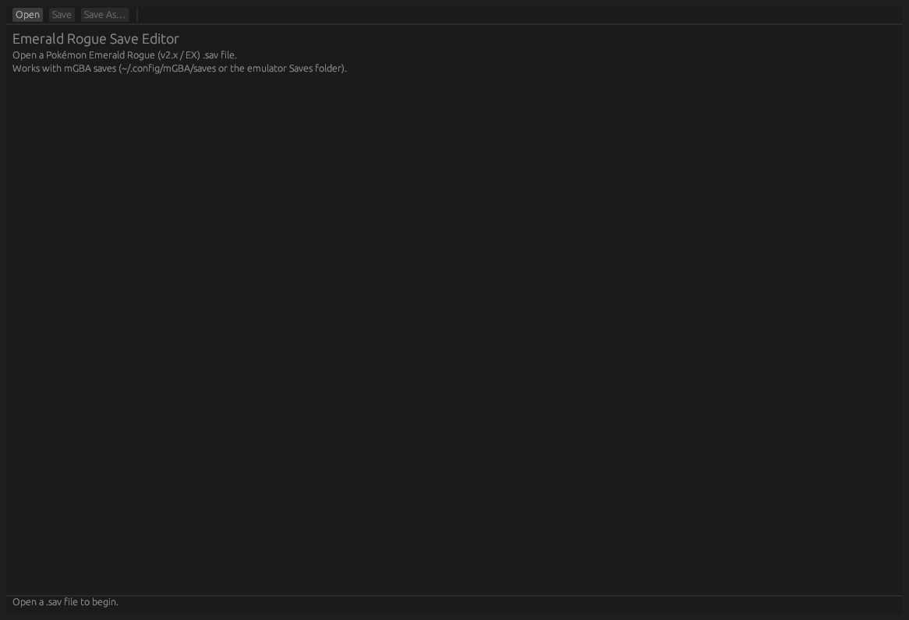

# Emerald Rogue Save Editor

A save-file editor for **[Pokémon Emerald Rogue](https://github.com/Pokabbie/pokeemerald-rogue)** (v2.x / EX branch) — a
decompiler-based ROM hack of Pokémon Emerald.

PKHeX does **not** support Emerald Rogue saves: Rogue resizes the Pokémon struct (80 → 104 bytes in the party),
grows the save blocks, and overlays its own adventure/quest/daycare state on top of the PC box storage. This project
reverse-engineers that layout from the game's own source and edits those saves natively, recomputing every
Pokémon- and sector-level checksum so the game accepts the result.

> **Status:** party/box/item/trainer editing, the Rogue adventure block (quests, campaigns, hub map, difficulty
> config, daycare), and the in-adventure vs. hub stashed state are editable, and a no-op resave round-trips
> losslessly. A few niceties remain — see [Roadmap](#roadmap).



## Features

**Working**

- Reads/writes mGBA- and VBA-style 128 KiB Emerald saves (32 × 4096 flash sectors + optional mGBA trailer)
- Picks the live save slot out of the two mirrored slots by sector counter, then merges the sector chain
- Full Pokémon decode/encode for both struct sizes (80-byte `BoxPokemon`, 104-byte Rogue `Pokemon`):
  PID, OT/OTID/SID, species, held item, level, EXP, IVs, EVs, moves, PP, nature, gender, ability, shiny,
  nickname, and the cached stat block
- Substruct permutation + `PID ^ OTID` encryption handled on write; Pokémon checksum and flash-sector checksum
  both recomputed (bad saves are rejected by the game)
- Stat recalculation from base stats + IV/EV/level/nature, using the game's own formulas
- Party, PC boxes (10 active), fusion storage, bag, PC item pouches, and money
- Player name, TID/SID, money, play time
- Full species/item tables including Rogue's added content: gen-9 dex, mega/gigantamax/Rogue form IDs,
  Rogue custom items, and Legends Z-A mega stones
- **Rogue save block** (the adventure state the vanilla layout has no room for):
  - Quests (all 232 slots, named, with state flags + highest-completed difficulty)
  - Campaigns (unlock/complete/best score)
  - Hub map: built areas, every named hub upgrade, **area coordinates** (move areas on the hub
    grid, with reachability warnings for islands / collisions / stranded neighbours), house
    exterior/interior/path styles, the 192 decoration slots (160 yard + 32 indoor), and the 10
    follow-mon slots incl. shininess
  - Lab difficulty settings: all 20 config toggles and 9 range slots (battle format, game mode,
    difficulty preset, revision mode, trainer order, …)
  - Hub time-of-day, season, weather (raw seed; the editor shows what each season's bucket yields);
    daycare (current state and stashed state)
- **In-adventure vs. hub state split**: SaveBlock1 holds whichever state is currently loaded; the other one
  is stashed inside the Rogue block (`sRunRestoreBlock`). The editor shows and edits **both** — stashed hub
  party, bag, daycare, money, and play time — so you can fix the state that the game is not currently showing.
- **Roster editing**: add a blank/level-100 mon to the party or a box, delete the selected mon, and move mons
  between party and boxes (delete keeps a one-slot undo)
- **Searchable pickers** for species, items, and moves: type to filter, arrows to move, Enter to pick.
  They stay open when you click the search field, auto-focus on open, and list every entry by default
- **Sprite art**: species and item icons in the roster, picker rows and item lists, from public
  repositories (see *Icon art* below). Missing art falls back to a letter badge, so the editor is fully
  usable without it
- Lossless round-trip: a no-op resave is byte-identical to the input (rotation, footers, trailer untouched)

**Known layout, not yet editable**

- Raw in-run structs (`gRogueRun`, adventure path): decoded for display, deliberately not editable mid-run
- Mon mastery flags, adventure-replay seeds (decoded; rarely useful to hand-edit)

## Install / build

Rust 2021 toolchain. The GUI uses [eframe/egui](https://github.com/emilk/egui) with `glow` (OpenGL), X11 and Wayland.

```sh
git clone https://github.com/ddxtanx/Emerald-Rogue-Save-Editor.git
cd Emerald-Rogue-Save-Editor
cargo build --release
./target/release/er-save-editor            # GUI
```

### Icon art (optional)

Sprites are **not** committed to this repository. Fetch them into `assets/` once — the editor looks for
`assets/icons/pokemon/<species-id>.png` and `assets/icons/items/<item-id>.png`, relative to the current
directory or to the executable:

```sh
python3 tools/get_icons.py                  # pokemon sprites, ~2200 PNGs, idempotent, resumable
python3 tools/get_icons_from_source.py      # item sprites, straight from the game's own source
```

`get_icons_from_source.py` shallow-clones the Emerald Rogue source (sparse: only `graphics/items`, `src/data`
and `include`) into `.cache/er-source/`, then follows the game's own wiring — item constant → icon table row
(or Rogue item row) → `INCBIN` line → the PNG and `.pal` that line names — and writes `<item id>.png` for every
id that has art. That is the art the ROM displays: extracting the same icons out of the ROM by hand reproduces
**857 of 862** ids byte-for-byte at GBA palette precision, the other five differing by one least-significant
palette bit, with no icon differing in shape or transparency. It replaces the item icons already in `assets/`;
ids this version of the game has no art for are left out, and the editor draws a letter-and-ball badge for those.

Pin a release with `--ref EX-v2.1`, or point it at an existing checkout with `--source /path/to/pokeemerald-rogue`.

Without them the editor still works: every icon slot falls back to a coloured letter badge, and the
mon editor header shows how many icons it found on disk.

On a headless box the GUI still runs under Xvfb + llvmpipe:

```sh
Xvfb :99 -screen 0 1280x800x24 -nolisten tcp &
DISPLAY=:99 LIBGL_ALWAYS_SOFTWARE=1 GALLIUM_DRIVER=llvmpipe ./target/release/er-save-editor
```

## Usage

```
er-save-editor FILE.sav              # GUI, opens the save instantly (read-only open)
er-save-editor                       # GUI: Open / Save / Save As, tabs for Party, Boxes, Items, Trainer
er-save-editor --cli FILE.sav        # decode a save to stdout (read-only, writes nothing)
er-save-editor --cli-edit FILE ...   # scripted edits (writes on invocation; see --dry-run)
```

Passing a file positionally (or `--open FILE`) opens it at launch — handy since
emulators keep saves at fixed paths (`mGBA: ~/.config/mGBA/saves/<game>.srm`).
`--cli-edit` stays deliberately small (`iv`, `money`, `noop`): it exists for
headless verification and round-trip testing, not as a full editing surface —
the GUI is the interactive interface for that.

### Write consent

**The editor never writes to disk unless you explicitly trigger a write.** Reads
and decoding are automatic; every write path is gated behind a deliberate
action, so a loaded save cannot be silently modified, re-checksummed, or
"helpfully" backed up:

- **GUI** — writing happens only via the **Save** / **Save As…** buttons. There is
  no autosave, no session restore, no backup file, no temp file. Your edits stay
  in memory (flagged `● modified`) until you press Save. Closing the app or
  opening another file discards unsaved edits.
- **`--cli FILE`** — strictly read-only.
- **`--cli-edit FILE …`** — invoking an edit *is* the consent; it writes in place.
  Add `--dry-run` to compute every edit and re-seal every checksum in memory
  while writing **zero bytes**, and see exactly what would change first.

```sh
# preview without touching the file (file stays byte-identical)
er-save-editor --cli-edit save.sav iv 0 1 31 --dry-run
```

Since a corrupted save is unrecoverable progress loss, keep your own backup
before real writes — the tool deliberately will not make one for you, and
`--cli` on a copy is the way to verify an edit decodes as intended.

`--cli-edit` subcommands today:

```sh
# set party slot 0, IV index 1 (Attack) to 31, and refresh the cached stat block
er-save-editor --cli-edit save.sav iv 0 1 31

er-save-editor --cli-edit save.sav money 9999999

# resave without touching data (used to prove the round-trip is lossless)
er-save-editor --cli-edit save.sav noop
```

Example `--cli` output (personal fields redacted):

```
file: save.sav
active slot: 1 (ctr 46 / 45)
slot1 valid: true  slot2 valid: true
player: "<name>" TID <tid> SID <sid>  playtime 38:41:39  money 5975

party[0] 0 species=59 (Arcanine)
  OT="<name>" lvl=54 nature=Adamant shiny=false genderFlag=1 ball=1 exp=16200 friendship=255
  IVs=[10, 18, 11, 26, 30, 11] EVs=[0, 0, 0, 0, 0, 0]
  moves=["Crunch", "Flare Blitz", "Extreme Speed", "Play Rough"] pp=[15, 15, 5, 10]
  checksum 48424 (OK), bad_egg=false
  stats cur/max = 166/166  atk=146 def=97 spe=121 spa=116 spd=97

party[1] 1 species=376 (Metagross)
  ...
box 0 ("BOX1"): 15 mons, first = Litwick checksum OK
```

## Project layout

```
src/main.rs        save model, sector/checksum machinery, mon decode/encode, GUI + CLI
src/tables.rs      species / moves / items / natures tables (generated from game headers)
src/basestats.rs   per-species base stats (generated from game species_info)
tools/             reverse-engineering and table-generation helpers (Python)
docs/FORMAT.md     the reverse-engineered save layout, with offsets and sources
docs/screenshot.png
```

- Field values are typed against the game's own enums (`Nature`, `SeasonDay`,
  `HubArea`, the three separate home-style types, …) so a season index cannot be
  passed where a day counter belongs. Types keep out-of-domain bytes verbatim
  rather than clamping them, so a save round-trips byte for byte.

## Development notes

`tools/` holds the scripts that produced the format knowledge and the generated tables. They expect a local checkout
of the game source and are driven by environment variables:

```sh
git clone -b expansion https://github.com/Pokabbie/pokeemerald-rogue.git rogue-src

ROGUE_SRC=rogue-src SPECIES_JSON=species_names.json python3 tools/gen_species_names.py
SAV_OUT=save-out-of-adventure.sav SAV_IN=save-in-adventure.sav python3 tools/diff_states.py
```

- `gen_species_names.py` — species id → name for the whole Rogue species space (Gen 1–9, Mega, Gigantamax,
  regional/alt forms, and Rogue's own fake forms — ~1400 ids, not the ~386 of vanilla Emerald)
- `gen_basestats.py`, `gen_rogue_items.py` — base-stat and Rogue-item tables
- `get_icons_from_source.py` — clones the game source and rebuilds every item icon from its own PNG and palette, id by id
- `diff_states.py`, `diff2.py` — locate every valid Pokémon struct in two saves and diff them by region; this is how
  the in-adventure vs overworld split was found
- `er_iv_edit.py`, `er_moveswap.py`, `er_sav_inspect.py` — early standalone Python prototypes

## Roadmap

- [x] Decode and edit the Rogue save block (quests, campaigns, daycare, hub map, difficulty config)
- [x] Expose both party/money/bag states explicitly (in-adventure run vs. persistent hub state)
- [x] Daycare editing (current and stashed)
- [x] Rogue custom item names (ids 827–1072, incl. Legends Z-A mega stones)
- [x] Species table completion (megas, gigantamax, Rogue form IDs, gen 9)
- [x] Safari-zone roster / dynamic unique-mon spawn editing
- [x] Searchable species/item/move pickers with sprite art from public repositories
- [x] Party/box roster editing: add, delete, move between party and storage
- [ ] Edit the raw in-run structs (`gRogueRun`, adventure path) — risky mid-run, likely read-only display
- [x] Save-version awareness: report which Rogue version wrote a save, and refuse to
      edit when the stream layout doesn't match the editor's map (the game migrates
      its own saves on load; the editor deliberately does not rewrite versions)
- [ ] Re-seal the Rogue block on save when a future game build changes the stream layout

## Licensing

The editor code in this repository is MIT-licensed (see [LICENSE](LICENSE)).

The tables in `src/tables.rs` and `src/basestats.rs` are generated from headers in
[Pokabbie/pokeemerald-rogue](https://github.com/Pokabbie/pokeemerald-rogue) (`expansion` branch), which is itself based
on [pret/pokeemerald](https://github.com/pret/pokeemerald) and
[rh-hideout/pokeemerald-expansion](https://github.com/rh-hideout/pokeemerald-rogue). Underlying Pokémon names, species,
moves and items are trademarks of Nintendo/Game Freak/Creatures Inc. Sprite art is *not* redistributed here:
`tools/get_icons.py` downloads pokemon sprites from public mirrors (PokeAPI's `sprites` repository and the same
asset sets pokemmo/Showdown publish), and `tools/get_icons_from_source.py` clones the Emerald Rogue source and
rebuilds item icons from the PNGs and palettes in that repository — both into your own `assets/` directory, at
your request, so the art stays under its own source's terms and never enters this repository. This tool is an unofficial interoperability
utility, unaffiliated with and not endorsed by Nintendo or the Emerald Rogue authors. It only edits your own save file.

## Disclaimer

Editing saves can corrupt them or make them unacceptable to the game, and modified saves may invalidate achievements
or online trades. **Back up your original `.sav` before editing.** No save files are committed to this repository on
purpose (`.gitignore` excludes `*.sav`) because they contain player names, trainer/secret IDs and personal progress.
